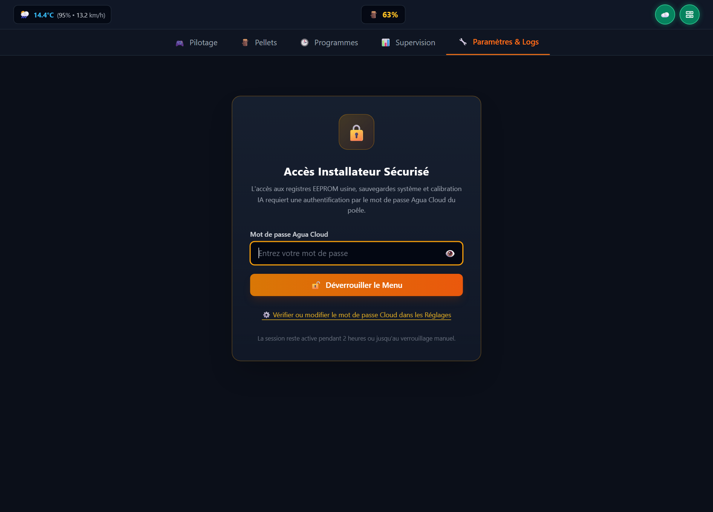
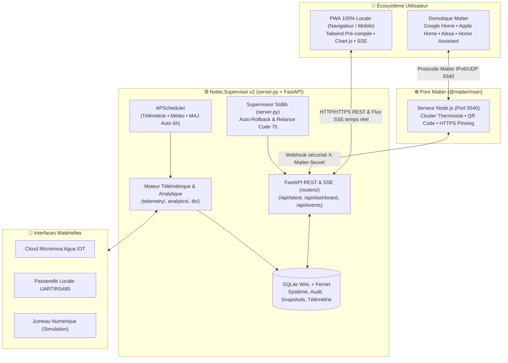

# 🔥 Nobis.Supervisor

> **Cockpit de supervision haute fidélité, télémétrie temps réel et passerelle domotique Matter locale pour poêles à granulés Nobis (gamme A10 / A8 C Light Style Coax - électronique Micronova).**

[](https://github.com/malexxx/Nobis.Supervisor/tree/v2)
[](https://www.python.org/)
[](https://fastapi.tiangolo.com/)
[](https://nodejs.org/)
[](https://csa-iot.org/all-solutions/matter/)
[](https://www.docker.com/)
[](https://web.dev/progressive-web-apps/)
[]()
[](LICENSE)

---

## 🖥️ Visite Guidée des Écrans (v2)

Découvrez l'interface de **Nobis.Supervisor v2**, pensée pour offrir une expérience réactive, moderne et autonome sur PC, tablette et smartphone :

---

### 1. 🎛️ Écran Pilotage Thermique — Cockpit Tri-Arc
> *Le centre névralgique de commande du poêle avec triple jauge circulaire interactive, suivi d'état en direct et accès immédiat aux fonctions de confort.*

<p align="center">
  
</p>

- **Triple Jauge Tri-Arc haute précision** : manipulation fluide à la souris ou au doigt de la **Consigne de Température** (7 à 40°C), de la **Puissance de chauffe** (P1 à P7) et de la **Vitesse de ventilation frontale** (0=OFF, 1 à 7, ou 8=Auto/PS).
- **Affichage Double-État** : distinction visuelle claire entre la consigne désirée (marqueur lumineux) et la valeur réelle instantanée mesurée par les thermocouples et capteurs de la carte mère.
- **Carrousel Tactile Multi-Zones** : navigation par balayage horizontal entre le **Salon (AMB)** et les canalisations d'air chaud **Gauche (SX)** et **Droite (DX)**.
- **Accès Rapide Confort** : activation en 1 clic du **Mode Silence !** temporisé, des bascules **Modulation Auto**, **Mode ECO (Stand-by)** et **BOOST (PWF)**, ainsi que la **Fleur du Cycle de Vie** (11 états Micronova).

---

### 2. 🪵 Écran Pellets, Trémie 35 kg & Autonomie Météo
> *Suivi précis du combustible restant, étalonnage couplé et calcul d'autonomie corrélé aux températures extérieures (DJU).*

<p align="center">
  
</p>

- **Jauge de Réservoir Granulés (35 kg)** : niveau en temps réel affiché en pourcentage (%) et en kilogrammes restants avec alerte visuelle sous le seuil critique de réserve.
- **Ravitaillement & Stock Sacs 15 kg** : boutons **"+1 Sac"** et **"100%"**, suivi des consommations et coûts **J / 7J / 30J**, et assistant dédié d'**étalonnage couplé (`/calibration`)**.
- **Météo Locale en Direct (Open-Meteo)** : température extérieure, vitesse du vent, humidité relative et calcul des **Degrés-Jours Unifiés (DJU Base 19°C)** sur 14 jours sans clé API.
- **Sondes Physiques Trappe & Trémie** : surveillance en direct des microswitchs de trappe granulés et niveau bas (Offset 115).

---

### 3. 📅 Écran Chrono — Programmation Hebdomadaire 4 Pistes
> *Planification fine du chauffage avec frise chronologique 4 pistes non superposées et synchronisation d'horloge RTC.*

<p align="center">
  
</p>

- **Frise Visuelle 4 Pistes Indépendantes** : programmes **P1** (Émeraude), **P2** (Ambre), **P3** (Cyan) et **P4** (Violet) sur une fenêtre glissante de 24h avec repère central temps réel.
- **Édition Intuitive des Programmes** : jours actifs (Lundi à Dimanche), plages de début/fin par pas de 10 minutes, consignes d'ambiance, canalisations SX/DX, puissance et ventilation.
- **Synchronisation Horloge Poêle (RTC)** : alignement en 1 clic de la date et de l'heure internes de la carte mère Micronova.

---

### 4. 📈 Écran Supervision — 4 Volets Synchronisés
> *Tableau de bord thermodynamique haute fidélité à 4 volets synchronisés à 60 FPS avec curseur unifié souris & tactile.*

<p align="center">
  
</p>

- **Portées Multi-Échelles (`3h`, `6h`, `24h`, `7j`, `30j`, `3M`)** : horodatage français (`JJ/MM HH:MM`) et export CSV Excel FR complet.
- **Volets 1 & 2 (Chart.js)** : températures salon, canalisations SX/DX, fumées, sonde K, consignes, puissance réelle, dépression (Pa), régime extracteur (RPM), niveau trémie (%) et tarages.
- **Volets 3 & 4 (Rubans Booléens & Sécurités)** : chronologie des 11 phases Micronova (avec stepper de cycle, fond coloré et bilans de durées), modes actifs et historique des sécurités (porte foyer, pressostat Pa, sondes TCK/TCJ, coupure secteur AL01, thermostats M/SX/DX, trappe et trémie).

---

### 5. 🔧 Écran Paramètres, HTTPS/TLS, MAJ Interne & Observabilité
> *Gestion complète du pont Matter, de la sécurité TLS, des mises à jour internes au conteneur, des sauvegardes ZIP et des registres EEPROM.*

<p align="center">
  
</p>

- **Mise à jour interne au conteneur** : vérification et installation directe depuis GitHub (`Branche v2`, `Releases`, `main`) dans `/app/data/updates/` avec sauvegarde ZIP pré-MAJ, vérification de santé au redémarrage interne (exit code `75`) et **auto-rollback** en cas d'anomalie — sans perte de données ni recréation du conteneur.
- **HTTPS / Certificat TLS Autonome** : certificat auto-signé par défaut ou **Let's Encrypt DNS-01** automatisé (`acme.sh` : DuckDNS, Cloudflare, OVH, Gandi, Infomaniak).
- **Sauvegarde & Restauration Atomique (`.zip`)** : export/import complet des bases SQLite, de la clé de chiffrement `.secret.key`, des certificats TLS et des données Matter, avec détection de persistance des volumes Docker.
- **Passerelle Matter Locale & Expert** : QR Code / code manuel d'appairage Matter, bascule à chaud `agua_cloud` / `local_gateway` / `simulation`, snapshots RAM/EEPROM, inspecteur des 76 offsets et logs conteneur temps réel.

---

### 📱 Vue Mobile Dédiée (PWA 100 % Hors-Ligne)
> *Une expérience d'application native sur iOS et Android sans dépendance CDN externe (Tailwind CSS pré-compilé et Chart.js embarqué).*

<p align="center">
  
</p>

- **Format Standalone** : plein écran optimisé sans ascenseur parasite, barre de navigation inférieure adaptée au pouce et cache PWA versionné (`sw.js` + cache-busting dynamique post-MAJ).

---

## 📖 Sommaire

- [Visite Guidée des Écrans (v2)](#-visite-guidée-des-écrans-v2)
- [Nouveautés de la Version 2](#-nouveautés-de-la-version-2)
- [Modes de Communication](#-modes-de-communication)
- [Architecture Technique](#-architecture-technique)
- [Arborescence du Projet](#-arborescence-du-projet)
- [Installation & Démarrage](#-installation--démarrage)
- [Configuration & Variables d'Environnement Docker](#-configuration--variables-denvironnement-docker)
- [Intégration Matter](#-intégration-matter)
- [API REST & Flux SSE](#-api-rest--flux-sse)
- [Tests Automatisés & Qualité](#-tests-automatisés--qualité)
- [Remerciements & Références Techniques](#-remerciements--références-techniques)
- [Avertissement & Licence](#-avertissement--licence)

---

## 🌟 Nouveautés de la Version 2

- 🏗️ **Architecture Modulaire & Performance x6** : découpage propre en packages (`routers/`, `services/`, `database/`, `clients/`, `telemetry/`, `analytics/`, `tls/`), projection SQL des 42 colonnes graphiques (-99 % de payload `/api/dashboard`), compression GZip sélective et rendu UI 60 FPS coalescé par `requestAnimationFrame`.
- 🔒 **Durcissement Sécurité Complet** : chiffrement Fernet au repos (`enc:v1:`) des secrets SQLite (`agua_password`, `https_dns_token`), authentification installateur par jeton, protection anti-SSRF stricte, CSP durcie (0 script inline, 0 CDN externe), HTTPS autonome et certificate pinning Matter.
- 🚀 **Superviseur de Mise à Jour Interne (`server.py`)** : mise à jour applicative en 1 clic à l'intérieur du conteneur Docker avec vérification de santé et rollback automatique.
- 💾 **Persistance Docker & Backup ZIP** : détection automatique des montages (`/app/data`), gestion de la trémie certifiée **35 kg** et assistant d'étalonnage couplé (`/calibration`).

---

## 📡 Modes de Communication

L'application prend en charge 3 modes de communication interchangeables à chaud (chacun isolé dans sa propre base SQLite) :

| Mode | Description | Cas d'usage |
| :--- | :--- | :--- |
| **`agua_cloud`** | **Client Cloud Micronova Agua IOT** : communique avec l'API Micronova par jeton JWT et protocole `RWMSmaster`. | Pilotage à distance sans modification matérielle de l'installation. |
| **`local_gateway`** | **Passerelle locale UART/RS485/Modbus** : interroge directement une passerelle matérielle connectée sur le port série de la carte mère. | Zéro latence, zéro cloud, résilience totale aux pannes Internet. |
| **`simulation`** | **Jumeau numérique physique haute fidélité** : simule la thermique du poêle, la montée en flamme, les dépressions, les alarmes et la consommation sans matériel physique. | Développement, démonstration, tests hors saison de chauffe. |

---

## 🏗️ Architecture Technique



---

## 📂 Arborescence du Projet

```text
Nobis_App/
├── Dockerfile                  # Image multi-stage (Node Matter, Tailwind CSS, Python 3.12)
├── docker-compose.yml          # Stack prête à l'emploi (Supervisor, Caddy, Watchtower)
├── docker-entrypoint.sh        # Initialisation droits /app/data et redirection server.py
├── server.py                   # Superviseur parent léger (MAJ interne & auto-rollback)
├── main.py                     # Application FastAPI v2, lifespan et montage des routeurs
├── config.py                   # Versions, chemins DATA_DIR et catalogue registres Micronova
├── schemas.py                  # Validation stricte Pydantic v2
├── scheduler.py                # Tâches périodiques APScheduler
├── routers/                    # Sous-routeurs API (admin, dashboard, stove, settings, tls, matter, calibration...)
├── services/                   # Services métier (update_service, update_bootstrap, storage_service, installer_auth, silence_service)
├── database/                   # SQLite WAL multi-bases, cache settings, migrations, chiffrement Fernet
├── clients/                    # Clients HTTPX (Agua Cloud, Passerelle Locale, Open-Meteo, Notifications)
├── telemetry/                  # Collecte, décodage trames Micronova, commandes et simulateur
├── analytics/                  # Évaluateur de combustion par lots, stabilité, prévisions autonomie
├── tls/                        # Gestion TLS autonome (auto-signé + Let's Encrypt acme.sh DNS-01)
├── matter_bridge/              # Pont Matter autonome Node.js (@matter/main)
├── static/                     # Frontend PWA modulaire (index.html, partials/, js/{core,features,charts}/, css/)
└── tests/                      # Suite de tests pytest, contrat OpenAPI Schemathesis et E2E Playwright
```

---

## 🚀 Installation & Démarrage

### Option 1 : Déploiement Docker (Recommandé)

```bash
git clone -b v2 https://github.com/malexxx/Nobis.Supervisor.git
cd Nobis.Supervisor
docker compose up -d
```

- L'interface est accessible sur **`http://127.0.0.1:1220`** (ou via Caddy sur le port **`1221`**, ou en HTTPS autonome selon `HTTPS_DEFAULT_MODE`).
- Le dossier `/app/data` **doit** être monté en volume persistant (`nobis_data:/app/data` ou bind mount hôte) pour conserver bases SQLite, `.secret.key`, certificats TLS, appairage Matter et mises à jour internes.

### Option 2 : Installation Manuelle (Local / Développement)

```bash
python3 -m venv .venv
source .venv/bin/activate   # ou .\.venv\Scripts\Activate.ps1 sous Windows
pip install -r requirements.txt

cd matter_bridge && npm install --omit=dev && cd ..
npm install && npm run build:css

python server.py --host 0.0.0.0 --port 8080
```

---

## ⚙️ Configuration & Variables d'Environnement Docker

Toutes les options applicatives peuvent être ajustées depuis l'onglet **🔧 Paramètres & Logs** ou via les variables d'environnement du conteneur Docker :

| Variable | Valeur par défaut image | Description |
| :--- | :--- | :--- |
| `APP_VERSION` | `2.4.0` | Version applicative embarquée dans l'image Docker (protégée contre toute variable obsolète antérieure au code) |
| `DOCKER_VERSION` | `v2.4.0` | Libellé de version Docker affiché dans le cockpit et retourné par `/health` |
| `NOBIS_IMAGE_COMMIT` | `""` (`ARG GIT_COMMIT`) | SHA du commit Git embarqué lors du build Docker |
| `DB_PATH` | `/app/data/nobis_a10.db` | Chemin de base permettant de résoudre `DATA_DIR` |
| `TZ` | `Europe/Paris` | Fuseau horaire du conteneur et des relevés |
| `HTTPS_DEFAULT_MODE` | `self_signed` (`http` en compose) | Mode TLS par défaut (`http`, `self_signed`, `letsencrypt`) |
| `TRUSTED_PROXY_IPS` | `127.0.0.1,::1` | Adresses IP de reverse-proxy autorisées pour les en-têtes `X-Forwarded-*` |
| `NOBIS_UPDATE_CHANNEL` | `v2` | Canal de mise à jour interne par défaut (`v2`, `releases`, `main`) |
| `GITHUB_TOKEN` | `""` | Jeton GitHub optionnel (évite le rate limit API ou permet l'accès à un fork privé) |
| `MATTER_PORT` | `5540` | Port réseau UDP/TCP du pont Matter local |

---

## 🌐 Intégration Matter

Le pont Matter embarqué expose le poêle en tant que **Thermostat** standard (`Device ID: 0x0301`) compatible **Google Home / Nest Hub Max**, **Apple Home / Siri**, **Amazon Alexa** et **Home Assistant**, avec QR Code et code d'appairage manuel disponibles dans **Paramètres & Logs → Domotique & Matter**.

---

## 🔌 API REST & Flux SSE

Documentation OpenAPI interactive disponible sur `/docs` :
- `GET /health` : état du conteneur, version `APP_VERSION` / `DOCKER_VERSION`, persistance stockage et statut communication.
- `GET /api/events` : flux Server-Sent Events (SSE) temps réel.
- `GET /api/latest` & `GET /api/dashboard?range_key=24h` : dernier état et séries temporelles (`3h`, `6h`, `24h`, `7j`, `30j`, `3M`).
- `POST /api/command` & `POST /api/command-batch` : écriture de registres RAM/EEPROM.
- `POST /api/silence/activate` & `/deactivate` : gestion du mode Silence ! temporisé.
- `GET /api/system/update/status`, `POST /api/system/update/check|apply|rollback|config` : pilotage des mises à jour internes.
- `GET /api/system/backup` & `POST /api/system/backup/restore` : sauvegarde et restauration ZIP complète.

---

## 🧪 Tests Automatisés & Qualité

```bash
ruff check .
node --check matter_bridge/bridge.mjs
pytest -v
```

La suite comprend plus de **155 tests** couvrant les algorithmes analytiques, les routes FastAPI, les contrats OpenAPI (**Schemathesis**), la sécurité / chiffrement Fernet / TLS, le superviseur de mise à jour interne et les tests E2E navigateur (**Playwright**).

---

## 🙏 Remerciements & Références Techniques

- **`py-agua-iot`** (FredericM, uapi et contributeurs) pour la documentation du protocole Micronova Agua IOT (`RWMSmaster`).
- **Open-Meteo** pour l'API météorologique locale sans clé obligatoire.
- **Matter.js (`@matter/main`)**, **FastAPI**, **Uvicorn**, **Chart.js** et **Tailwind CSS**.
- **Poêles Nobis S.r.l.** (gamme *A10 C Light Style Coax*) & **cartes Micronova S.r.l.** (*V018_1*).

---

## ⚖️ Avertissement & Licence

- **Avertissement** : projet communautaire indépendant, non affilié à **Nobis S.r.l.** ou **Micronova S.r.l.**. L'usage des commandes installateur et écritures EEPROM relève de la responsabilité de l'utilisateur.
- **Licence** : distribué sous licence **MIT**.
