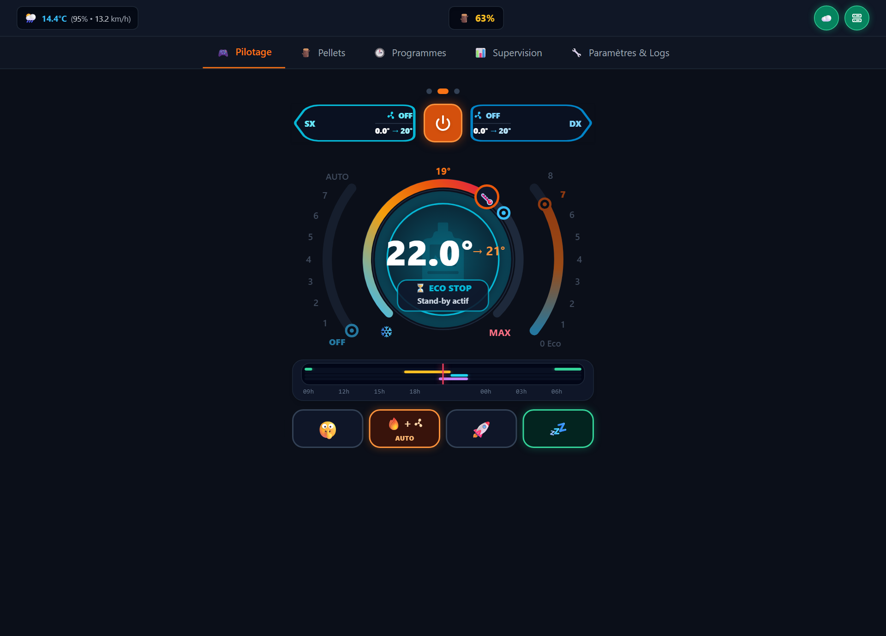
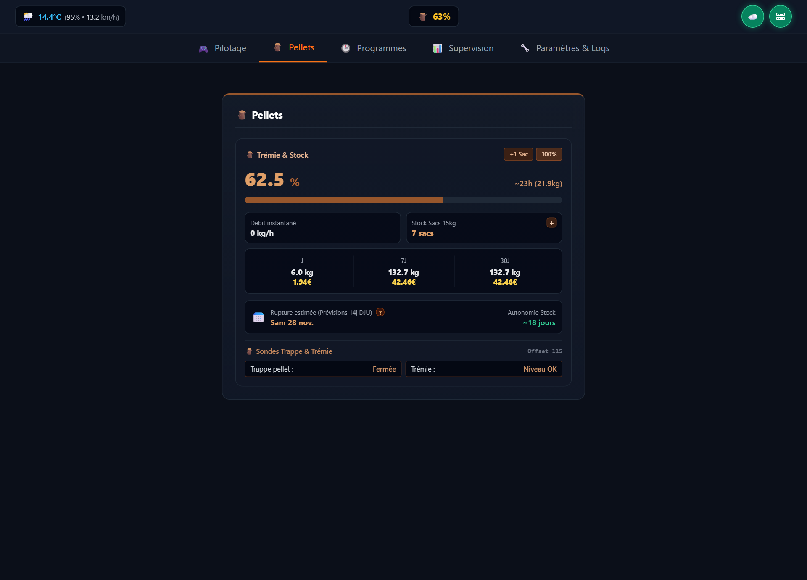
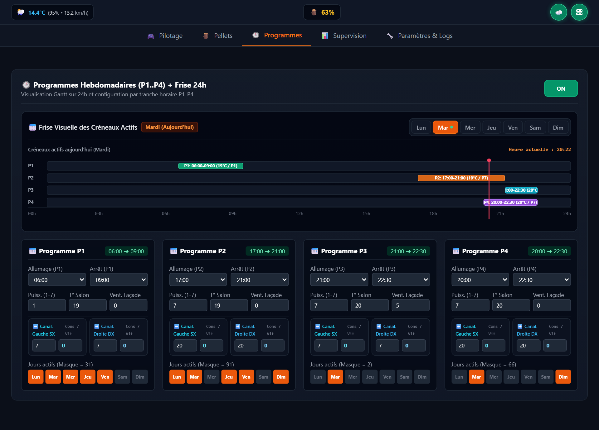
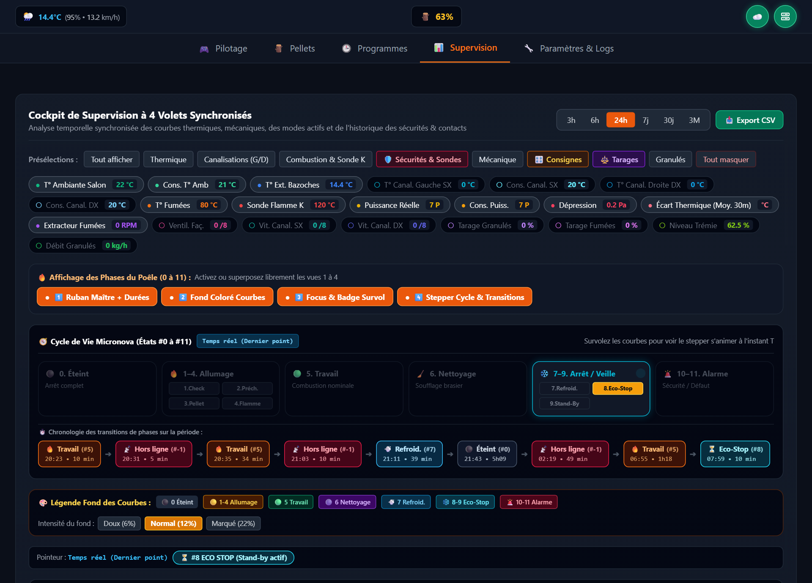
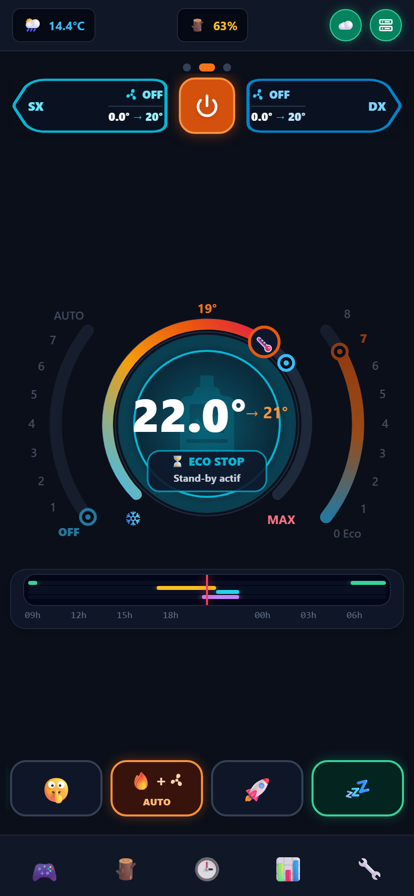
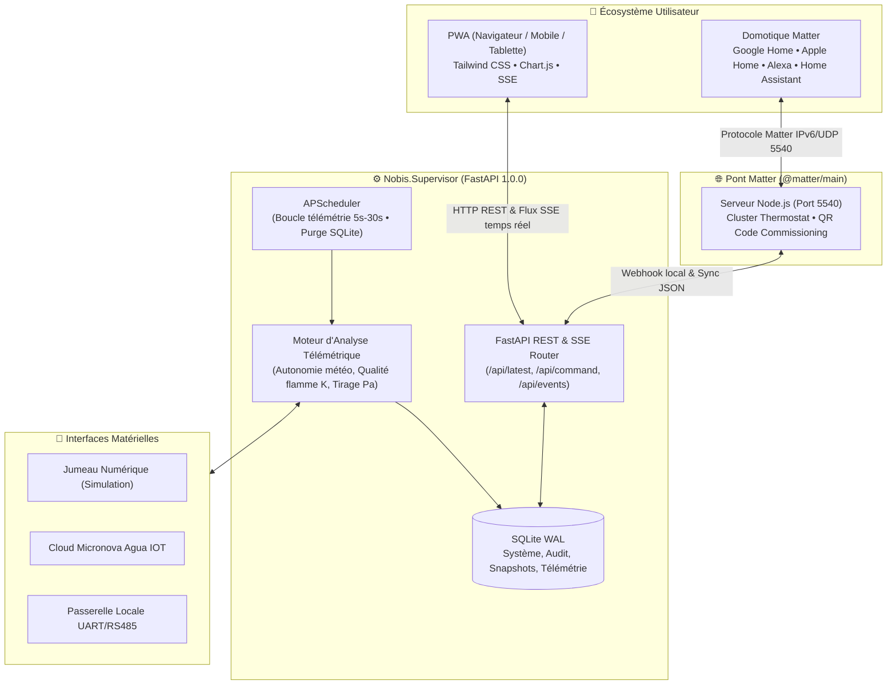

# 🔥 Nobis.Supervisor

> **Cockpit de supervision haute fidélité, télémétrie temps réel et passerelle domotique Matter locale pour poêles à granulés Nobis (gamme A10 / A8 C Light Style Coax - électronique Micronova).**

[](https://github.com/malexxx/Nobis.Supervisor/releases/tag/v1.0)
[](https://www.python.org/)
[](https://fastapi.tiangolo.com/)
[](https://nodejs.org/)
[](https://csa-iot.org/all-solutions/matter/)
[](https://www.docker.com/)
[](https://web.dev/progressive-web-apps/)
[]()
[](LICENSE)

---

## 🖥️ Visite Guidée des Écrans

Découvrez l'interface de **Nobis.Supervisor v1.0**, pensée pour offrir une expérience réactive, moderne et épurée sur PC, tablette et smartphone :

---

### 1. 🎛️ Écran Pilotage Thermique — Cockpit Tri-Arc
> *Le centre névralgique de commande du poêle avec triple jauge circulaire interactive, suivi d'état en direct et accès immédiat aux fonctions de confort.*

<p align="center">
  
</p>

- **Triple Jauge Tri-Arc haute précision** : manipulation fluide à la souris ou au doigt de la **Consigne de Température** (7 à 40°C), de la **Puissance de chauffe** (P1 à P7) et de la **Vitesse de ventilation frontale** (0=OFF, 1 à 7, ou 8=Auto/PS).
- **Affichage Double-État** : distinction visuelle claire entre la consigne désirée (marqueur lumineux) et la valeur réelle instantanée mesurée par les thermocouples et capteurs de la carte mère.
- **Bandeau de Statut & Sécurité** : état temps réel du poêle (Allumage, Travail, Nettoyage, Arrêt, Alarme) avec bouton Marche/Arrêt sécurisé.
- **Accès Rapide Confort** : activation en 1 clic du **Mode Silence !** temporisé, des bascules **Modulation Auto**, **Mode ECO (Stand-by)** et **BOOST (PWF)**.
- **Canalisations Séparées** : volets dédiés pour la gestion indépendante des ventilateurs de canalisation d'air chaud Gauche (SX) et Droite (DX).
- **Mini-Frise Hebdomadaire intégrée** : projection miniature des plages programmées avec ligne rouge centrale marquant l'heure courante.

---

### 2. 🪵 Écran Pellets, Trémie & Autonomie Météo
> *Suivi précis du combustible restant, ravitaillement express et calcul d'autonomie corrélé aux températures extérieures.*

<p align="center">
  
</p>

- **Jauge de Réservoir Granulés (30 kg)** : niveau en temps réel affiché en pourcentage (%) et en kilogrammes restants avec alerte visuelle sous le seuil critique de réserve.
- **Ravitaillement en 1 clic** : bouton **"+ Sac 15 kg"** pour ajouter rapidement un sac lors du rechargement avec plafonnement automatique à 30 kg et mise à jour de l'historique.
- **Météo Locale en Direct (Open-Meteo)** : température extérieure, vitesse du vent, humidité relative et conditions atmosphériques locales sans clé API.
- **Prédiction d'Autonomie (Runway)** : estimation dynamique du nombre de jours de chauffage restants selon la consommation réelle de la vis sans fin d'alimentation (`auger_duty_pct`) et la rigueur climatique prévue sur les 7 prochains jours.

---

### 3. 📅 Écran Chrono — Programmation Hebdomadaire 4 Pistes
> *Planification fine du chauffage avec frise chronologique 4 pistes non superposées et synchronisation d'horloge NTP.*

<p align="center">
  
</p>

- **Frise Visuelle 4 Pistes Indépendantes** :
  - **P1** (Vert Émeraude)
  - **P2** (Ambre Chaleureux)
  - **P3** (Cyan Lumineux)
  - **P4** (Violet Moderne)
- **Repère Temporel Central** : ligne verticale rouge à 50% matérialisant l'instant présent sur une fenêtre glissante de 24h (12h passées / 12h à venir) sans encombrement textuel superflu.
- **Édition Intuitive des Programmes** :
  - Sélection des jours actifs de la semaine (Lundi au Dimanche).
  - Plages de début et de fin par incréments de 10 minutes.
  - Consignes thermiques dédiées par programme : température d'ambiance, puissance de flamme et ventilation.
- **Synchronisation NTP en 1 Clic** : bouton permettant d'aligner l'horloge interne de la carte mère Micronova avec la seconde exacte de votre serveur ou box domotique.

---

### 4. 📈 Écran Supervision & Télémétrie Graphique
> *Tableau de bord thermodynamique haute fidélité avec graphiques Chart.js et indicateurs de santé du foyer.*

<p align="center">
  
</p>

- **Graphiques Historiques Interactifs** : sélecteur de portée temporelle multi-échelle (**1h, 6h, 12h, 24h, 7 jours, 30 jours**).
- **Courbes Thermiques & Aérauliques** :
  - Température des fumées (°C) vs régime de l'extracteur (RPM).
  - Température ambiante mesurée vs température de consigne.
  - Dépression du foyer en Pascal (Pa) pour la surveillance du tirage du conduit coaxial.
- **Qualité de Combustion** : indicateur temps réel corrélant la température du thermocouple flamme K aux débits théoriques attendus.
- **Compteur de Maintenance CAT** : suivi du temps de fonctionnement résiduel avant le passage obligatoire d'entretien préventif des 2500 heures.

---

### 5. 🔧 Écran Paramètres, Pont Matter & Installateur
> *Gestion de la connectivité Matter, choix du mode de communication matériel, sauvegardes EEPROM et diagnostic des alarmes.*

<p align="center">
  
</p>

- **Passerelle Matter Locale** : affichage du **QR Code SVG** haute résolution et du code manuel d'appairage local (sans cloud) pour Google Home, Apple Maison / Siri, Amazon Alexa et Home Assistant.
- **Bascule de Mode de Communication** : passage à chaud entre `simulation` (jumeau numérique physique), `agua_cloud` (API Cloud Micronova) et `local_gateway` (passerelle locale UART/RS485).
- **Instantanés de Configuration (Snapshots)** : sauvegarde complète de tous les registres RAM et EEPROM en base SQLite avec restauration totale en 1 clic.
- **Audit des Ordres & Rollback** : journal horodaté de toutes les commandes émises avec possibilité de rollback unitaire en cas d'erreur de manipulation.
- **Gestionnaire d'Alarmes & Défauts** : diagnostic immédiat parmi les 29 codes de sécurité Micronova (AL01 à AL29) et commande de réarmement à distance.

---

### 📱 Vue Mobile Dédiée (PWA Installable)
> *Une expérience d'application native sur iOS et Android sans passer par les stores d'applications.*

<p align="center">
  
</p>

- **Format Standalone** : plein écran sans barre d'adresse ni boutons de navigation du navigateur.
- **Ergonomie Touch Optimisée** : zones de saisie agrandies pour un confort parfait au pouce et navigation tactile par barre d'onglets inférieure.
- **Support Hors-Ligne & Cache Rapide** : Service Worker v1.0 avec mise en cache locale des assets.

---

## 📖 Sommaire

- [Aperçu & Objectifs](#-aperçu--objectifs)
- [Visite Guidée des Écrans](#-visite-guidée-des-écrans)
- [Nouveautés de la Version 1.0](#-nouveautés-de-la-version-10)
- [Fonctionnalités Principales](#-fonctionnalités-principales)
  - [Pilotage Thermique & Cockpit Tri-Arc](#-pilotage-thermique--cockpit-tri-arc)
  - [Mode Silence ! Temporisé](#-mode-silence--temporisé)
  - [Chrono Hebdomadaire (P1 à P4)](#-chrono-hebdomadaire-p1-à-p4)
  - [Gestion de Trémie & Autonomie Météo](#-gestion-de-trémie--autonomie-météo)
  - [Diagnostics Avancés & Maintenance Prédictive](#-diagnostics-avancés--maintenance-prédictive)
  - [Pont Domotique Matter Local](#-pont-domotique-matter-local)
  - [Sauvegarde, Audit & Snapshots](#-sauvegarde-audit--snapshots)
- [Modes de Communication](#-modes-de-communication)
- [Architecture Technique](#-architecture-technique)
- [Arborescence du Projet](#-arborescence-du-projet)
- [Installation & Démarrage](#-installation--démarrage)
  - [Option 1 : Déploiement Docker (Recommandé)](#option-1--déploiement-docker-recommandé)
  - [Option 2 : Installation Manuelle (Local / Développement)](#option-2--installation-manuelle-local--développement)
- [Configuration](#-configuration)
- [Intégration Matter (Google Home, Apple Home, Alexa)](#-intégration-matter)
- [API REST & Flux SSE](#-api-rest--flux-sse)
- [Tests Automatisés](#-tests-automatisés)
- [Remerciements & Crédits](#-remerciements--crédits)
- [Références & Documentation Technique](#-références--documentation-technique)
- [Dépannage & FAQ](#-dépannage--faq)
- [Avertissement & Licence](#-avertissement--licence)

---

## 🎯 Aperçu & Objectifs

Le poêle à pellets étanche et coaxial **Nobis A10 C Light Style Coax** (comme l'ensemble des poêles Nobis motorisés par carte électronique **Micronova**) est un équipement de chauffage haut de gamme alliant convection naturelle, ventilation forcée et régulation fine. Bien que performant, son utilisation au quotidien via les solutions mobiles d'origine souffre souvent de dépendances au cloud constructeur, de latences et de l'absence d'intégration domotique locale.

**Nobis.Supervisor** apporte une solution complète, moderne et autonome :
1. **Souveraineté locale** : fonctionnement 100% autonome sur votre réseau local (via passerelle locale ou jumeau numérique) avec bascule transparente vers le cloud Micronova Agua IOT si désiré.
2. **Interface PWA moderne** : cockpit web ultra-réactif, installable sur smartphone/tablette/PC (icône dédiée, mode plein écran, thème sombre soigné avec effet *glassmorphism*).
3. **Passerelle Matter native** : appairage direct du poêle en tant que thermostat standard avec Google Home, Nest Hub Max, Apple Home / Siri, Alexa et Home Assistant, sans passer par un cloud externe.
4. **Précision & Télémétrie** : suivi en temps réel par Server-Sent Events (SSE) de tous les registres RAM/EEPROM, calcul dynamique de l'autonomie en granulés corrélé aux prévisions météo locales (Open-Meteo), indices de qualité de combustion et suivi d'usure CAT.

---

## 🌟 Nouveautés de la Version 1.0

- 🎛️ **Cockpit Tri-Arc Révolutionnaire** :
  - Remplacement des sliders classiques par 3 jauges circulaires haute précision : **Température**, **Puissance de chauffe** et **Ventilation d'ambiance**.
  - **Affichage Double-État** : visualisation simultanée de la **valeur de consigne** (repère visuel immédiat) et de la **valeur réelle mesurée** en temps réel par les sondes de la carte mère.
  - Manipulation fluide au doigt (tactile mobile) ou à la souris avec verrouillage contextuel de la zone manipulée.
  - Gestion précise du niveau 7 et du mode automatique 8 (*PS Auto*).
- 📊 **Frise Chronologique Hebdomadaire 4 Pistes** :
  - 4 pistes visuelles indépendantes pour les programmes P1 (Émeraude), P2 (Ambre), P3 (Cyan) et P4 (Violet).
  - Fin des chevauchements illisibles : chaque plage horaire est projetée sur sa propre ligne temporelle.
  - Grisement dynamique des programmes désactivés et ligne rouge centrale de repère temporel en temps réel.
- ⚡ **Performance & Sécurité Renforcées** :
  - Audit complet du code : suppression des fonctions et écouteurs orphelins, minification du cycle de rendu.
  - 42 tests automatisés couvrant l'analyse télémétrique, la cartographie des registres Micronova et les endpoints REST.

---

## ✨ Fonctionnalités Principales

### 🎛️ Pilotage Thermique & Cockpit Tri-Arc
- **Marche / Arrêt sécurisé** avec gestion des phases de transition (Préchauffage, Allumage, Travail, Nettoyage, Arrêt/Refroidissement).
- **Consigne de température ambiante** réglable de 7 à 40°C (ou 41°C = Mode Manuel continu).
- **Puissance de combustion** échelonnée de P1 à P7.
- **Ventilation frontale** réglable de 0 (OFF / Convection naturelle pure) à 7, ou 8 (*PS Auto* proportionnel à la puissance de chauffe).
- **Canalisations d'air indépendantes** : gestion séparée de la canalisation **Gauche (SX)** et de la canalisation **Droite (DX)** (consigne de température de 7 à 40°C et vitesse de soufflerie de 0 à 8).
- **Modes de combustion automatiques** :
  - **Modulation Auto** : ajustement dynamique de la puissance selon le différentiel de température.
  - **Mode ECO (Stand-by)** : coupure et réallumage automatiques dès que la température de consigne est atteinte.
  - **Mode BOOST (PWF)** : surpuissance temporaire pour réchauffer rapidement la pièce.

### 🤫 Mode Silence ! Temporisé
Une exclusivité conçue pour les moments de repos ou de lecture :
- **Activation en 1 clic** : bascule immédiatement le poêle en **convection naturelle 100% silencieuse**.
- Bride la puissance sur **P1** et coupe l'intégralité des ventilateurs (Frontale, Canalisations SX et DX à 0).
- Désactive temporairement les modes Auto, ECO et BOOST.
- **Temporisation réglable** : présélections rapides 1h, **2h (défaut)**, 3h, 4h ou saisie personnalisée en minutes/heures.
- Compte à rebours dynamique affiché sur le bouton de commande.
- **Restauration automatique** : à la fin du timer, les réglages initiaux de puissance et de ventilation sont automatiquement rétablis.

### 📅 Chrono Hebdomadaire (P1 à P4)
- **4 plages programmables indépendantes** (P1, P2, P3, P4).
- Sélection des jours actifs via masques hebdomadaires (Lundi au Dimanche).
- Définition pour chaque programme de :
  - L'heure de démarrage et d'extinction (au pas de 10 minutes).
  - La puissance de consigne (P1 à P7).
  - La température ambiante souhaitée.
  - La température et vitesse des canalisations Gauche et Droite.
  - La vitesse du ventilateur d'ambiance frontal.
- **Synchronisation d'horloge NTP en 1 clic** : met à l'heure la date et l'heure internes de la carte mère du poêle avec l'horloge système.

### 🪵 Gestion de Trémie & Autonomie Météo
- Suivi du niveau de granulés dans le réservoir de **30 kg** (affichage en pourcentage et en kilogrammes).
- Bouton de remplissage rapide **"+ Sac 15 kg"** avec plafonnement automatique à 30 kg.
- Consommation calculée en continu d'après le temps d'activation de la vis sans fin d'alimentation (`auger_duty_pct`).
- **Prévisions météo locales intégrées** (API Open-Meteo) : température extérieure, humidité, vent et historique récent.
- **Calcul prévisionnel de l'autonomie restante (Runway en jours)** basé sur les moyennes thermiques extérieures prévues pour les prochains jours.

### 🔍 Diagnostics Avancés & Maintenance Prédictive
- **Indice de qualité des granulés** : compare en temps réel la température de la sonde de flamme K à la courbe théorique attendue selon la puissance sélectionnée (pastille colorée : optimale, acceptable ou dégradée).
- **Indice d'extraction & tirage** : surveille la dépression du foyer en Pascal (Pa), le régime de l'extracteur de fumées (RPM) et la température des gaz brûlés.
- **Tarages installateur (Trims)** : ajustement fin du chargement granulés (-30% à +30%) et de la vitesse de l'extracteur de fumées (-30% à +30%).
- **Compteur de maintenance CAT** : décompte des heures de fonctionnement avant l'entretien obligatoire des 2500 heures.
- **Gestion des alarmes Micronova** : détection et libellé explicite des 29 codes d'alarme de sécurité (AL01 Black-out, AL02 Manque allumage, AL03 Manque pellets, AL11 Dépression tirage, AL15 Sécurité porte/cendres, etc.) avec bouton de réinitialisation.

### 🌐 Pont Domotique Matter Local
- Embarque un pont Matter autonome écrit en Node.js moderne avec `@matter/main`.
- Expose le poêle sur le réseau local en tant qu'accessoire **Thermostat standard**.
- Compatible avec les contrôleurs du marché :
  - **Google Home** & **Nest Hub / Nest Hub Max**
  - **Apple HomeKit**, **Apple TV**, **HomePod** (avec commande vocale Siri)
  - **Amazon Alexa**
  - **Home Assistant** (intégration Matter officielle)
- Affichage direct du **QR Code d'appairage** SVG et du code manuel dans l'onglet Installateur.
- Synchronisation bidirectionnelle : une consigne modifiée sur Google Home ou Apple Home met à jour le poêle, et un changement manuel sur le poêle remonte aussitôt sur les applications domotiques.

### 💾 Sauvegarde, Audit & Snapshots
- **Snapshots de registres** : mémorisez l'état complet de vos registres EEPROM/RAM avant modification et restaurez-les à tout moment.
- **Audit des commandes & Rollback** : chaque ordre envoyé au poêle est consigné dans une base SQLite. Possibilité de faire un retour arrière (*Rollback*) sur n'importe quel ordre unitaire.
- **Export CSV** : téléchargez en un clic l'historique complet de télémétrie ou les logs pour une analyse sous Excel / Grafana.
- **Webhooks & Alertes Push** : notifications instantanées (Discord, Slack, ntfy.sh, Home Assistant) lors d'un défaut, d'une alarme ou d'un niveau bas de trémie (protection anti-SSRF incluse).

---

## 📡 Modes de Communication

L'application prend en charge 3 modes de communication interchangeables à chaud :

| Mode | Description | Cas d'usage |
| :--- | :--- | :--- |
| **`simulation`** | **Jumeau numérique physique haute fidélité** : simule la thermique du poêle, la montée en flamme, les dépressions, les alarmes et la consommation de combustible sans matériel physique. | Développement, démonstration, tests hors saison de chauffe. |
| **`agua_cloud`** | **Client Cloud Micronova Agua IOT** : communique avec l'API officielle Micronova par jeton JWT et protocole `RWMSmaster`. | Pilotage à distance sans modification matérielle de l'installation. |
| **`local_gateway`** | **Passerelle locale UART/RS485/Modbus** : interroge directement une passerelle matérielle connectée sur le port série de la carte mère. | Zéro latence, zéro cloud, résilience totale aux pannes Internet. |

---

## 🏗️ Architecture Technique



---

## 📂 Arborescence du Projet

```text
Nobis_App/
├── docker-compose.yml          # Déploiement multi-conteneurs prêt à l'emploi
├── Dockerfile                  # Image Docker basée sur python:3.12-slim + Node.js 20
├── requirements.txt            # Dépendances Python (FastAPI, Uvicorn, APScheduler, Pydantic, HTTPX)
├── docs/
│   └── screenshots/            # Captures d'écran du cockpit v1.0
│       ├── cockpit_triarc_v1.0.png
│       └── cockpit_timeline_v1.0.png
├── data/                       # Données persistantes montées en volume (bases SQLite, Matter)
│   ├── nobis_a10_system.db     # Configuration, audits, snapshots, réglages
│   ├── nobis_a10_*.db          # Historique télémétrique selon le mode actif
│   └── matter_storage/         # Clés cryptographiques et fabrications Matter
├── main.py                     # Serveur FastAPI v1.0, endpoints REST et flux SSE
├── config.py                   # Constantes poêle (alarmes AL01-AL29, registres EEPROM/RAM)
├── database.py                 # Gestion SQLite en mode WAL, migrations, snapshots et audits
├── clients.py                  # Clients HTTPX (Agua IOT Cloud, Passerelle Locale, Open-Meteo)
├── schemas.py                  # Modèles de validation des données Pydantic v2
├── telemetry.py                # Algorithmes thermodynamiques, calculs d'autonomie et débits
├── matter_service.py           # Superviseur Python du sous-processus Node.js Matter Bridge
├── matter_bridge/              # Pont Matter autonome en Node.js
│   ├── package.json            # Dépendances @matter/main et qrcode
│   └── bridge.mjs              # Serveur de cluster Thermostat Matter
├── static/                     # Frontend PWA v1.0 (Single Page Application)
│   ├── index.html              # Cockpit Tri-Arc, panneaux de contrôle, onglets
│   ├── manifest.json           # Manifest PWA installable v1.0.0
│   ├── sw.js                   # Service Worker et cache nobis-cockpit-v1.0
│   ├── css/styles.css          # Thème sombre, animations flamme et ventilation
│   └── js/
│       ├── app.js              # Contrôleur Tri-Arc, synchronisation SSE, modales
│       ├── state.js            # Gestion d'état réactive côté client
│       └── charts.js           # Rendu des graphiques historiques Chart.js
└── tests/                      # Suite de tests automatisés (42 tests)
    ├── test_analytics.py       # Validation des algorithmes de qualité et d'autonomie
    ├── test_api.py             # Tests d'intégration des routes REST et sécurité
    ├── test_collector_mapping.py # Validation des correspondances registres RAM/EEPROM
    └── test_schemas.py         # Validation des schémas Pydantic
```

---

## 🚀 Installation & Démarrage

### Option 1 : Déploiement Docker (Recommandé)

Le déploiement sous Docker est la solution la plus simple et la plus fiable. L'image embarque à la fois l'environnement Python 3.12 et le runtime Node.js nécessaire au pont Matter.

1. **Cloner le dépôt Git :**
   ```bash
   git clone https://github.com/malexxx/Nobis.Supervisor.git
   cd Nobis.Supervisor
   ```

2. **Lancer le conteneur avec Docker Compose :**
   ```bash
   docker compose up -d
   ```

3. **Accéder à l'application :**
   - Ouvrez votre navigateur sur : **`http://localhost:8080`** (ou l'adresse IP locale de votre machine / Raspberry Pi).
   - Les données et états Matter sont automatiquement persistés dans le répertoire `./data`.

4. **Consulter les journaux d'exécution :**
   ```bash
   docker compose logs -f nobis-supervisor
   ```

---

### Option 2 : Installation Manuelle (Local / Développement)

#### Prérequis
- **Python 3.11** ou **Python 3.12**
- **Node.js 20+** et **npm** (pour le pont Matter)

#### Étapes

1. **Cloner le dépôt :**
   ```bash
   git clone https://github.com/malexxx/Nobis.Supervisor.git
   cd Nobis.Supervisor
   ```

2. **Configurer l'environnement virtuel Python :**
   ```bash
   # Sous Linux / macOS
   python3 -m venv .venv
   source .venv/bin/activate

   # Sous Windows PowerShell
   python -m venv .venv
   .\.venv\Scripts\Activate.ps1

   # Installation des dépendances
   pip install -r requirements.txt
   ```

3. **Installer les dépendances du pont Matter :**
   ```bash
   cd matter_bridge
   npm install --omit=dev
   cd ..
   ```

4. **Démarrer le superviseur :**
   ```bash
   # Lancement direct avec Python (serveur Uvicorn intégré)
   python main.py

   # Ou via Uvicorn (recommandé avec rechargement à chaud)
   uvicorn main:app --host 0.0.0.0 --port 8080 --reload
   ```

L'application initialise automatiquement les bases de données SQLite nécessaires dans `data/` et démarre en mode `simulation` par défaut.

---

## ⚙️ Configuration

Toutes les configurations principales peuvent être ajustées directement depuis l'onglet **"Installateur"** de l'interface web, ou via des variables d'environnement.

### Variables d'Environnement Disponibles

| Variable | Valeur par défaut | Description |
| :--- | :--- | :--- |
| `DB_PATH` | `/app/data/nobis_a10.db` | Chemin du dossier des bases SQLite |
| `TZ` | `Europe/Paris` | Fuseau horaire pour l'horodatage des relevés |
| `NOBIS_API_URL` | `http://127.0.0.1:8080` | URL FastAPI utilisée par le pont Matter |
| `MATTER_PORT` | `5540` | Port réseau UDP/TCP pour le protocole Matter |
| `MATTER_CONTROL_PORT`| `5549` | Port de contrôle interne du pont Matter |
| `MATTER_PASSCODE` | `20202021` | Code secret d'appairage Matter |
| `MATTER_DISCRIMINATOR`| `3840` | Discriminateur d'appairage Matter |

---

## 📱 Intégration Matter

Le pont Matter intégré expose votre poêle sous forme d'un **Thermostat** standardisé :

```text
Type d'appareil : Thermostat (Device ID: 0x0301)
Nom par défaut  : Poêle Nobis A10
Passcode        : 20202021
Discriminator   : 3840
Port Matter     : 5540 (UDP / TCP)
```

### Procédure d'Appairage

1. Dans l'interface web, rendez-vous dans l'onglet **🔧 Installateur** > section **Pont Matter**.
2. Vérifiez que le statut indique **"En ligne / Opérationnel"**.
3. Sur votre smartphone (connecté au même réseau Wi-Fi local avec Bluetooth activé) :
   - **Google Home** : Appuyez sur `+` > *Configurer un appareil* > *Appareil compatible avec Matter* > Scannez le QR Code affiché à l'écran.
   - **Apple Home** : Ouvrez Maison > `+` > *Ajouter un accessoire* > Scannez le QR Code.
   - **Alexa / Home Assistant** : Choisissez l'ajout d'appareil Matter et suivez les instructions.
4. Une fois appairé, vous pouvez piloter votre poêle à la voix ou via vos automatisations :
   - *"Dis Google, règle le poêle à 21 degrés."*
   - *"Dis Siri, éteins le poêle du salon."*

---

## 🔌 API REST & Flux SSE

Le superviseur met à disposition une API REST moderne et documentée, accessible directement sur `/docs` (Swagger UI interactif).

### Endpoints Principaux

| Méthode | Route | Description |
| :--- | :--- | :--- |
| `GET` | `/health` | Bilan de santé du service, statut SQLite et mode actif |
| `GET` | `/api/events` | Flux Server-Sent Events (SSE) temps réel (données poêle, météo, alertes) |
| `GET` | `/api/latest` | Dernier enregistrement complet de télémétrie et registres |
| `GET` | `/api/dashboard?range_key=24h` | Historique agrégé pour les courbes graphiques (1h, 6h, 12h, 24h, 7j, 30j) |
| `POST` | `/api/command` | Écriture d'un registre (`reg_key`, `new_val`) |
| `POST` | `/api/command-batch` | Écriture groupée de plusieurs registres en une seule requête |
| `POST` | `/api/silence/activate` | Activation du mode Silence ! avec durée en heures |
| `POST` | `/api/silence/deactivate` | Fin anticipée du mode Silence ! et restauration des paramètres |
| `GET` | `/api/silence/status` | Statut du mode Silence et compte à rebours restant |
| `GET` | `/api/matter/status` | Statut du pont Matter, QR Code d'appairage et code manuel |
| `POST` | `/api/matter/restart` | Redémarrage du sous-processus pont Matter |
| `POST` | `/api/matter/factory-reset`| Réinitialisation d'usine des appairages Matter |
| `POST` | `/api/refill-hopper` | Ajout de granulés dans la trémie (ex: +15 kg) |
| `POST` | `/api/sync-clock` | Synchronisation de l'horloge interne du poêle avec l'heure NTP |
| `GET` | `/api/snapshots` | Liste des sauvegardes de configuration |
| `POST` | `/api/snapshots` | Création d'un instantané de tous les registres |
| `POST` | `/api/snapshots/{id}/restore`| Restauration intégrale d'un instantané |
| `POST` | `/api/rollback/{audit_id}`| Annulation ciblée d'un ordre d'écriture antérieur |
| `GET` | `/api/export-csv` | Téléchargement des relevés télémétriques au format CSV |

---

## 🧪 Tests Automatisés

Une suite complète de **42 tests automatisés** valide la robustesse du superviseur (schémas Pydantic, calculs thermodynamiques, cartographie des registres RAM/EEPROM, sécurité SSRF et routes HTTP) :

```bash
# Exécution de la suite complète avec pytest
pytest

# Ou avec unittest natif Python
python -m unittest discover -s tests
```

```text
============================= test session starts =============================
collected 42 items

tests/test_analytics.py ................                                 [ 38%]
tests/test_api.py ................                                       [ 76%]
tests/test_collector_mapping.py ....                                     [ 85%]
tests/test_schemas.py ......                                             [100%]

============================== 42 passed in ~16s ==============================
```

---

## 🙏 Remerciements & Crédits

Ce projet s'appuie sur le travail remarquable de développeurs open source et de communautés passionnées. Nous tenons à remercier tout particulièrement :

- **La communauté Agua IOT & Home Assistant** :
  - **FredericM**, **uapi** et les contributeurs de la bibliothèque Python [**`py-agua-iot`**](https://github.com/frederic/py-agua-iot), dont les travaux pionniers d'ingénierie inverse sur les API Micronova Agua IOT (`RWMSmaster`, gestion des jetons JWT et structures JSON) ont rendu possible l'interfaçage transparent avec les poêles connectés.
  - Les contributeurs des intégrations Home Assistant Micronova pour leurs retours d'expérience sur la robustesse des flux de données.
- **L'équipe Open-Meteo** :
  - Pour leur magnifique [API Météo Open-Meteo](https://open-meteo.com/), rapide, précise et accessible sans clé API obligatoire, permettant d'alimenter les prévisions thermodynamiques et le calcul d'autonomie de la trémie.
- **Le projet Matter.js (@matter/main)** :
  - Pour la réalisation d'une pile logicielle Matter moderne en TypeScript/Node.js, permettant de créer des ponts domotiques locaux performants sans dépendance propriétaire.
- **Les auteurs de FastAPI, Uvicorn et Chart.js** pour la qualité de leurs fondations techniques.

---

## 📚 Références & Documentation Technique

Pour les installateurs, techniciens chauffagistes et développeurs souhaitant approfondir le fonctionnement matériel et électronique :

### 1. Documentation Poêles Nobis S.r.l.
- **Modèle de référence** : *Nobis A10 C Light Style Coax* (poêle à pellets étanche avec conduit concentrique coaxial, régulation automatique du tirage et double canalisation indépendante).
- **Notices techniques & guides d'installation** :
  - Manuel officiel d'utilisation et d'entretien Nobis (*Istruzioni per l'uso e la manutenzione - Stufe a pellet ermetiche con condotto coassiale*).
  - Principe du **Brasier autonettoyant mécanique** (*Braciere autopulente brevettato*) garantissant des cycles de combustion continus avec décendrage automatique.
  - Technologie **Confort Mode** : coupure totale de la ventilation forcée pour un fonctionnement en convection naturelle silencieuse.
  - Fonction **Powerful (PWF)** : montée rapide en température par activation conjointe de la puissance de combustion maximale et de la ventilation dynamique.
  - Site officiel : [nobisfire.com](https://www.nobisfire.com/)

### 2. Documentation Cartes Électroniques Micronova S.r.l.
- **Cartes électroniques compatibles** : Familles Micronova **I023**, **L023**, **V018_1** avec microcontrôleurs dédiés au pilotage thermique de poêles à granulés et modules Wi-Fi **Agua IOT** / **Navel**.
- **Cartographie des Registres Mémoire** :
  - **Mémoire RAM dynamique (Adresses 0x00 à 0x7F / Registres 0 à 127)** :
    - `0` : État opérationnel du poêle (0=Off, 1=Contrôle flamme, 2=Allumage, 3=Travail, 4=Nettoyage, 5=Extinction, 6=Blocage/Alarme).
    - `1` : Vitesse réelle de l'extracteur de fumées (RPM).
    - `2` : Puissance de travail active (P1 à P7).
    - `3` : Vitesse réelle du ventilateur d'ambiance (V0 à V7).
    - `5` : Température réelle des fumées (°C) via thermocouple sonde K.
    - `6` : Température réelle de la sonde d'ambiance (°C).
    - `7` : Signal de dépression du pressostat différentiel / dépressomètre (Pa).
    - `12` : Rapport cyclique du temps d'alimentation de la vis sans fin d'alimentation pellets (`auger_duty_pct`).
  - **Mémoire EEPROM non volatile (Adresses 0x2000 à 0x8214 / 33120 à 33300)** :
    - `33120` : Consigne de température ambiante souhaitée (7°C à 40°C, 41°C = Manuel).
    - `33121` : Consigne de puissance de chauffe désirée (P1 à P7).
    - `33122` : Consigne de vitesse de ventilation (0=Off, 1-7=Fixe, 8=Auto/PS).
    - `33123` : Consigne de température canalisation Gauche (SX).
    - `33124` : Vitesse de soufflerie canalisation Gauche (SX).
    - `33125` : Consigne de température canalisation Droite (DX).
    - `33126` : Vitesse de soufflerie canalisation Droite (DX).
    - `33130` : Activation du Mode ECO / Stand-by (0=Désactivé, 1=Activé).
    - `33131` : Activation du Mode Chrono Hebdomadaire (0=Off, 1=On).
    - `33200..33280` : Tables de programmation hebdomadaire Chrono P1 à P4 (masques de jours, heures de début/fin, consignes thermiques associées).
- **Protocoles de communication** :
  - Protocole série propriétaire maître-esclave Micronova (trames d'interrogation RAM et d'écriture EEPROM sous contrôle de somme de contrôle checksum).
  - Protocole API Cloud Micronova `RWMSmaster` avec chiffrement de session et jeton Bearer JWT.

---

## 🛠️ Dépannage & FAQ

<details>
<summary><b>1. Le pont Matter n'apparaît pas ou le QR Code ne scanne pas</b></summary>

- Assurez-vous que le port UDP **5540** n'est pas bloqué par un pare-feu local (nécessaire pour la découverte mDNS Matter).
- Si vous utilisez Docker, vérifiez que le mapping de port `5540:5540/udp` et `5540:5540/tcp` est bien présent dans votre `docker-compose.yml`.
- Dans l'onglet Installateur, vous pouvez déclencher une **Réinitialisation d'usine Matter** pour régénérer un identifiant d'appairage propre.
</details>

<details>
<summary><b>2. Comment passer du mode Simulation au poêle réel ?</b></summary>

1. Rendez-vous dans l'onglet **🔧 Installateur**.
2. Dans le bloc **Mode de communication**, sélectionnez :
   - **Agua Cloud** : renseignez votre email, mot de passe Agua IOT et identifiant client.
   - **Passerelle Locale** : renseignez l'adresse IP locale de votre passerelle (ex: `http://192.168.1.150`).
3. Cliquez sur **Enregistrer les paramètres**. Le superviseur bascule immédiatement sur votre installation physique.
</details>

<details>
<summary><b>3. Comment installer la PWA sur iPhone / Android ?</b></summary>

- **Sur iPhone / iPad (Safari)** : appuyez sur le bouton *Partager* (carré avec flèche vers le haut) > sélectionnez **Sur l'écran d'accueil**.
- **Sur Android (Chrome)** : appuyez sur le menu `⋮` > sélectionnez **Ajouter à l'écran d'accueil** ou **Installer l'application**.
- L'application se comporte alors comme une application native sans barre d'adresse ni boutons de navigation du navigateur.
</details>

---

## ⚖️ Avertissement & Licence

- **Avertissement** : Ce projet est un développement communautaire indépendant et n'est ni affilié à, ni approuvé par la société **Nobis S.r.l.** ou **Micronova S.r.l.**. L'utilisation des commandes installateur et des réglages de registres relève de la responsabilité de l'utilisateur.
- **Licence** : Distribué sous licence open-source **MIT**. Vous êtes libre de l'utiliser, de le modifier et de le distribuer.

---

<p align="center">
  Fait avec passion pour le confort thermique et la domotique ouverte 🏡🔥
</p>
